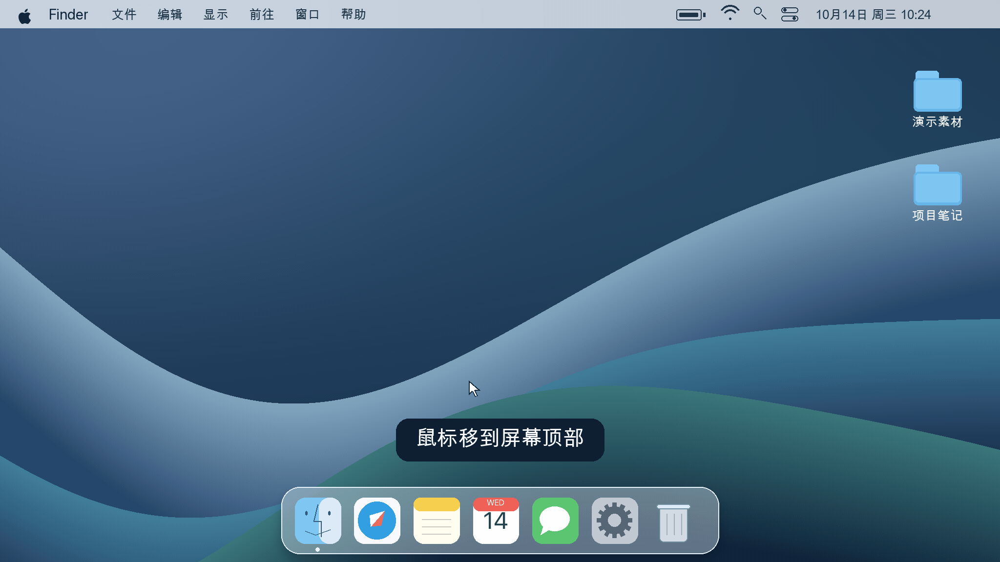
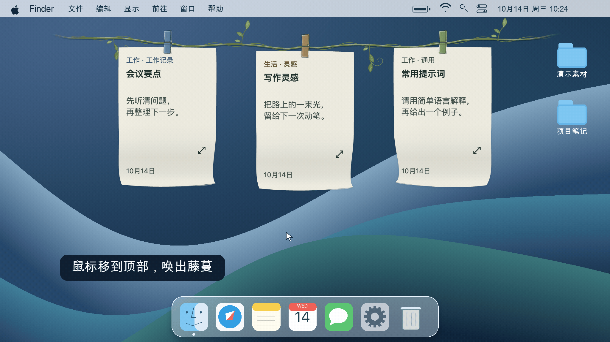
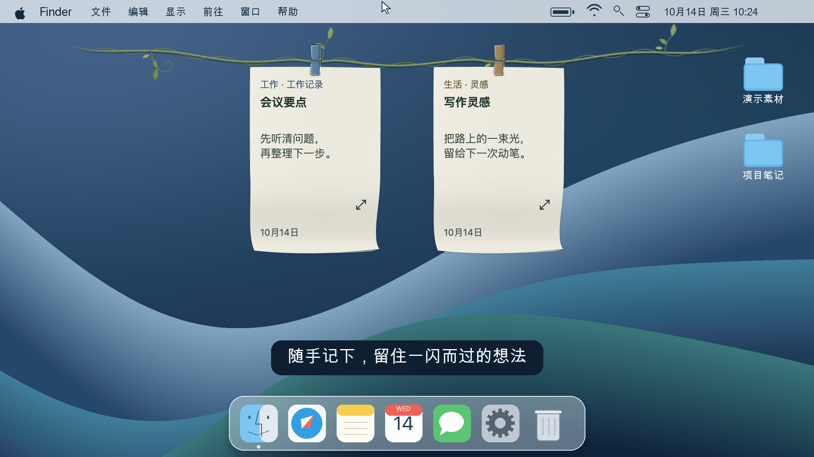
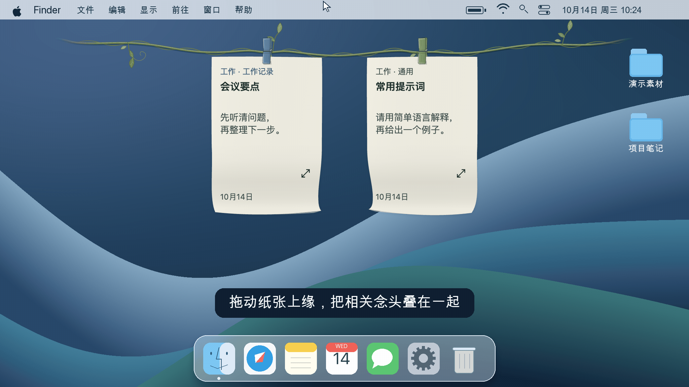
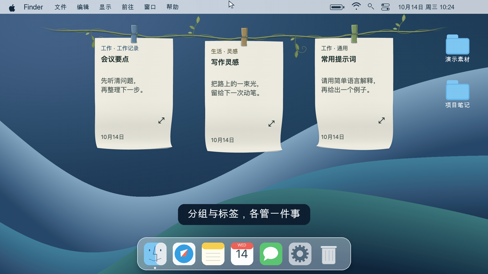

<h1 align="center">
   
  晾念头 · Thoughtline
</h1>

  <strong>把念头晾起来，让灵感随手可见。</strong> 
  桌面顶边的一条藤蔓，留住灵感、工作记录和常用提示词。

  
  
  

<a href="README.md">中文</a> · <a href="docs/readme/README.en.md">English</a> · <a href="docs/readme/README.ja.md">日本語</a> · <a href="docs/readme/README.ko.md">한국어</a> · <a href="docs/readme/README.es.md">Español</a> · <a href="docs/readme/README.fr.md">Français</a> · <a href="docs/readme/README.pt.md">Português</a>

<h2 align="center"><a href="https://github.com/NocodeMrLi/thoughtline/releases/tag/v0.0.37">下载 Thoughtline</a></h2>

macOS Apple Silicon · Windows x64 · 0.0.37

Thoughtline（晾念头）是一款 macOS 与 Windows 桌面便签工具。鼠标移到屏幕顶边，藤蔓和便签就会展开；离开后收起，桌面继续留给手头的工作。用几只彩色夹子挂住眼前需要的内容，再用分组、标签和日历保存更多念头。

<strong>点击一键复制　·　拖入聊天输入框</strong>

  
  

点击一键复制 · <a href="docs/readme/demos/zh/vine-overview.png">静态预览</a>　｜　拖入聊天输入框 · <a href="docs/readme/demos/zh/text-drag.png">静态预览</a>

<a href="#real-interface">查看真实界面</a>

演示采用模拟 macOS 桌面、藤蔓和虚构念头；菜单对应实际产品结构，聊天输入框为示意。

## 适合留住这些念头

- 工作中的待办线索、会议要点和临时记录。
- 写作或生活中一闪而过的想法，留到合适的时候继续。
- 常用提示词、回复片段和参考文字，需要时取出全文。

## 写下、晾起、取用、回看

1. **写下**：用快捷键或便签右键打开新建窗，填写名称或正文，选择分组、标签。
2. **晾起**：把眼前需要的念头挂在顶边；相关纸张可以叠在同一夹子里。
3. **取用**：点击便签正文一键复制；用展开图标阅读全文、编辑，或把正文拖到其他软件。
4. **回看**：暂时不用就收起到日历，之后按日期或搜索找回。

菜单栏／托盘图标提供暂停悬停、恢复悬停和退出；新建、筛选与日历使用快捷键或便签右击菜单，设置在日历更多菜单中。

## 可以做什么

<strong>快速新建　·　拖动叠放</strong>

  
  

快速新建 · <a href="docs/readme/demos/zh/quick-capture.png">静态预览</a>　｜　拖动叠放 · <a href="docs/readme/demos/zh/drag-stack.png">静态预览</a>

### 随手记录，保留草稿

名称与正文至少填写一项，只有标题也能保存。未提交内容可作为草稿保留；在展开详情或日历中编辑，短暂停顿后自动保存。

### 分组负责归类，标签负责辨认

用分组区分工作、生活或不同项目，用标签标记主题、角色或用途。两种筛选独立，同时启用时只显示两者都匹配的念头；筛选只改变展示，保留真实叠放关系和位置。标签面板支持从标签名、念头名称和正文关键词查找对应标签。

   
  只看分组 → 筛选标签 → 显示全部 · <a href="docs/readme/demos/zh/groups-and-tags.png">静态预览</a>

### 多张纸叠放，逐张阅读

同一分组内可合并不同标签；未分组的念头按相同标签合并。每张纸的名称、正文、标签、颜色、提醒和创建日期独立保留。翻页或点击页码打开标题列表，直接跳到想看的纸张；也可拆出当前一张。

### 挂绳与日历衔接

合并面板可搜索兼容的挂绳或日历目标。合并到日历的叠放继续留在日历，拆分后也留在日历。拖动夹子移动整叠，拖纸张上缘抽出单张；自动整理收拢间距，支持最近一次仍有效操作的撤销。筛选与合并小面板可拖动，按 Esc 或点击面板外关闭。

### 按原日期找回内容

日历提供日、月、年浏览，以及名称、正文、分组和标签搜索、状态筛选。点击挂绳便签的日期，可定位对应念头。叠放卡片显示真实张数；成员保留各自创建日期，跨日期的纸张仍能从原日期找到。

   
  点击纸张日期 → 定位念头 → 展开全文 · <a href="docs/readme/demos/zh/calendar-revisit.png">静态预览</a>

### 复制全文，随手取用

复制或从正文拖出纯文本后，原念头继续保留。复制成功在按钮附近显示“已复制”。你决定内容放到哪里；应用不会自动把文字发送给其他软件或 AI 服务。

### 提醒需要继续的事

通过小铃铛设置单次提醒，到时使用系统通知，点击查看对应念头。系统需要允许通知，应用需要保持运行；退出期间错过的提醒会在重新打开时提示。

### 绳满也能继续记

可选 4、6、8 个夹子，默认 6 个。绳满时仍可保存到日历，或选择“换上”，让旧念头收起、腾出位置。主动收起的内容留在日历，由你决定何时挂回。

### 整理分类时，选择保留还是清空

分组与标签管理支持创建、改名、移除选用和恢复选用。删除默认“保留内容并迁移”；也可选择“彻底删除分组／标签及内容”，在同一弹窗查看清单，再勾选不可撤销确认。标签删除范围包含跨分组的同标签内容与关联草稿；默认“通用／未分组”受保护。

## 下载与安装

当前版本为 **0.0.37**，通过仓库 Releases 分发；下载需要相应仓库访问权限。

| 平台 | 安装包 |
| --- | --- |
| macOS · Apple Silicon | [Thoughtline-0.0.37-mac-arm64.dmg](https://github.com/NocodeMrLi/thoughtline/releases/tag/v0.0.37) |
| Windows · x64 | [Thoughtline-0.0.37-win-x64.exe](https://github.com/NocodeMrLi/thoughtline/releases/tag/v0.0.37) |

Mac 打开 DMG，将 Thoughtline 拖入“应用程序”；Windows 运行 EXE，按安装向导完成。升级前正常退出旧版，并保留独立备份。当前手动下载更新。

Mac 安装包使用本地 ad-hoc 签名，尚未公证；Windows 安装包未进行代码签名。安装时可能出现系统信任提示。

## 第一次使用

1. 按 `Control + Alt + N` 新建念头；Mac 为 `⌃ + ⌥ + N`。快捷键可在设置中修改。
2. `Enter` 换行；Mac 用 `⌘ + Enter` 提交，Windows 用 `Ctrl + Enter` 提交。新建窗按 `Esc` 保存草稿并关闭。
3. 鼠标移到屏幕顶边呼出挂绳，点击正文一键复制，点击展开图标阅读全文；右键进入新建、筛选、日历或整理。
4. 日历右上角更多菜单提供“最近删除”“分组与标签”“存储与设置”。

## 给桌面一点自己的风格

在“存储与设置 → 外观”选择经典细绳、编织棉绳或轻藤蔓。经典细绳可调色，棉绳和藤蔓保留各自的自然色；夹子颜色跟随标签。

纸张提供五种柔和预设颜色，以及空白、细横线、轻虚线。先预览，点击“应用”再保存。界面可切换中文／English、浅色／深色，或跟随系统。

  
  

深色主题 · 中文界面　｜　浅色主题 · English 界面 macOS 实际效果；Windows 因系统略有差异，功能一致。

## 数据、导出与删除

念头保存在本机。设置中可查看实际保存目录、迁移到新位置、导出 JSON 备份；迁移会先复制并校验，原目录副本保留。TXT、DOCX 用于导出名称与正文，JSON 用于备份完整念头数据。

普通删除念头进入“最近删除”，可以恢复。彻底删除会清除当前记录，不进入最近删除，也不能通过普通撤销恢复；已有自动备份与导出文件保留。彻底删除分组或标签时，会同时清除对应范围内挂绳、日历、最近删除的内容与关联草稿。

升级或换设备前保留一份独立备份。恢复历史备份、跨设备搬运或回退旧版本前，应保留当前数据并确认格式兼容。

## 常见问题

### 分组和标签怎么用？

例如“工作”是分组，“日报”是标签。只筛标签可跨分组找日报；同时选择工作与日报，只看二者都匹配的念头。

### 收起、删除、彻底删除有什么区别？

收起只是移到日历；普通删除进入最近删除；彻底删除清除当前记录。整理时默认迁移保留内容，清空内容需要明确选择并确认。

### 需要账号或云服务吗？

使用应用无须注册 Thoughtline 账号，念头由本地文件保存。当前版本提供本地存储与备份，跨设备搬运需自行使用备份文件。仓库下载权限与应用使用是两回事。

### Codex 等标签会连接 AI 吗？

这些名称是你为内容设置的标签，用于分类和取用。Thoughtline 不会通过标签连接 Agent API；需要使用提示词时，由你复制或拖出文字。

## 反馈与联系

可通过“存储与设置”中的联系入口联系作者，有仓库访问权限时也可提交 [GitHub Issues](https://github.com/NocodeMrLi/thoughtline/issues)。请说明系统、应用版本、操作步骤及预期与实际结果；截图和示例内容请先脱敏。

## 许可与致谢

当前源码许可标记为 `UNLICENSED`，尚未授予开源使用许可。第三方代码与许可证单独保留，见[第三方声明](THIRD_PARTY_NOTICES.md)。

本页提供七种语言的产品文档；应用界面目前支持中文与 English。
