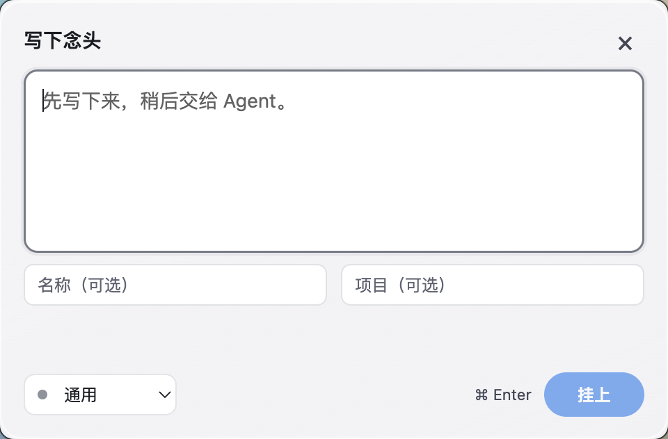
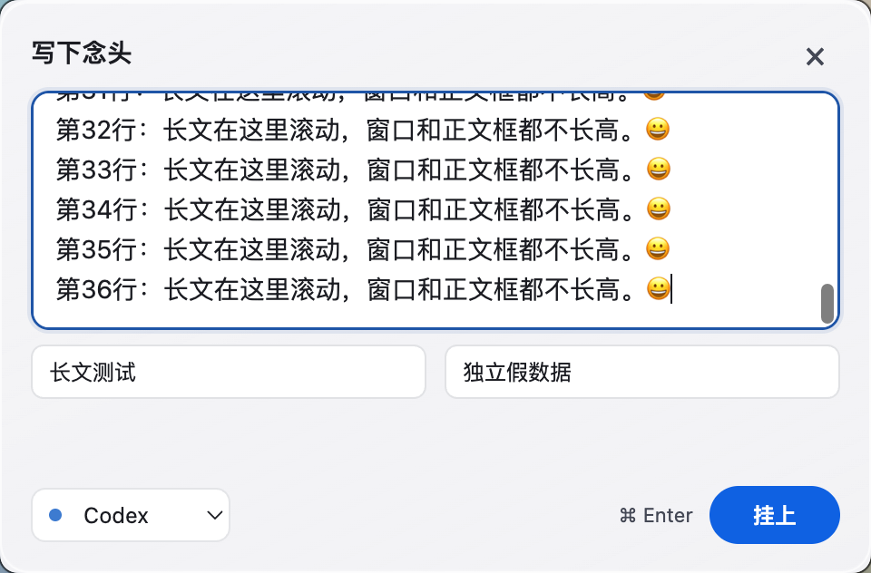

# 紧凑输入窗实际 Mac 预览

固定源码 `ebd585ae5e3d4c5d505fe52b03c203517cc8f88f`，独立分支 `codex/thoughtline-compact-composer-20261009`，0.0.16-preview.3。0.0.15包、旧530×520被拒图和草稿恢复检查点保持原阶段；此版未打新包。

实际窗口480×316DIP；正文固定132DIP，约五行。长文框内滚动，正文和窗口均不增高。名称与项目两列常显，底部仅Agent、键提示与提交；描边随Agent，通用中性、Codex蓝、Claude暖赭。标题/正文不染色。查找/已收起仅在既有系统Thoughtline图标菜单按需打开，绳上没有新菜单或工具条。

| 默认 | 长文滚动 |
|---|---|
|  |  |

[Codex短文](evidence/compact-composer/codex-short-light-native-desktop.png)、[Claude暖边](evidence/compact-composer/claude-short-light-native-desktop.png)、[深色长文](evidence/compact-composer/codex-long-scroll-dark-native-desktop.png)、[深色Claude](evidence/compact-composer/claude-short-dark-native-desktop.png)。这些是系统compositor实际裁切本测试窗口，窗口下仅自有干净渐变背景，未拍无关窗口、未改系统壁纸或设置。DPR2，PNG960×632。

## 材质真实边界

本机macOS15.3.1、Electron44.7.0；本地electron.d.ts支持vibrancy、visualEffectState、Windows backgroundMaterial，未升级依赖。代码用原生popover vibrancy、followWindow与克制高光/层次；[Electron窗口API](https://www.electronjs.org/docs/latest/api/base-window)。它不是AppKit的[NSGlassEffectView](https://developer.apple.com/documentation/appkit/nsglasseffectview)，不能声称原生Liquid Glass完整实现。

**当前系统同时开启降低透明度和增强对比度，实际窗口正确走opaque回退。** 因此本轮图没有证明真实桌面模糊玻璃质感；没有强改用户系统设置或用CSS伪造模糊后冒称原生。材质和系统偏好原值逐场景记录在[实际结果](evidence/compact-composer/preview-result.json)。原生vibrancy在允许透明度的环境效果仍待实际图验证；[Electron nativeTheme](https://www.electronjs.org/docs/latest/api/native-theme)说明这些系统偏好。

Windows方案采用Segoe UI Variable/Segoe UI、方圆角控件与Ctrl Enter，支持Win11 build22621起的原生Acrylic；老系统、失焦、降低透明度/高对比/forced colors走不透明回退。[微软Acrylic适用临时表面](https://learn.microsoft.com/en-us/windows/apps/design/style/acrylic)。[浅色Windows样式模拟](evidence/compact-composer/windows-style-simulation-light.png)、[深色模拟](evidence/compact-composer/windows-style-simulation-dark.png)只是Mac renderer切换Windows CSS/不透明分支，不是Windows运行截图，更不证明Acrylic/实机交互。

## 已复验与未验收

22文件96单测、类型/构建通过。当前preview实际窗口截图专项exit0：八场景、短长正文132不变，长文scrollHeight812>clientHeight129且scrollTop683，字段/完整32px按钮在框内、提交键与按钮同排、Agent描边确实不同。首轮旧footer子元素样式使按钮纵排，几何红事实和图保留在before-footer-fix，修正后重新截图并加入按钮包含断言。

当前受影响安全原生和异常终止恢复均exit0：新UI实际系统Tray MenuItem的查找入口→管理→重开；草稿/全文/字段恢复；合成IME负向等2.4秒并检查窗口可见/锁/revision后再正向保存；失败保文重试；三点击一条及迟到同会话拒绝；编辑取消不污染正文/新建草稿；dirty正常退出重启。系统Menu回调不等于物理点击菜单，合成组合事件不等于系统IME。单慢IO仅由scheduler单元覆盖，没有刻意在native中注入慢磁盘。

[源、编译、截图及测试绑定](evidence/compact-composer/source-binding.json)、[预览清理](evidence/compact-composer/preview-cleanup.json)、[安全结果](evidence/compact-composer/safety-native.json)、[崩溃恢复](evidence/compact-composer/crash-recovery.json)、[单测](evidence/compact-composer/unit.log)。假数据已清理，自有进程均退出；未读取用户便签、改用户安装版或创建发布。

新建草稿只保证已完成的原子检查点，节流等待或写入完成前异常终止仍可丢最后一小段；不保证未提交编辑异常恢复或断电零丢失。当前视觉待用户认可，允许透明度环境的玻璃观感、物理Mac/Windows输入法/焦点/穿透/系统键盘/真实Agent/G7和新冻结包完整矩阵仍未验收。`formalAcceptance=false`。
