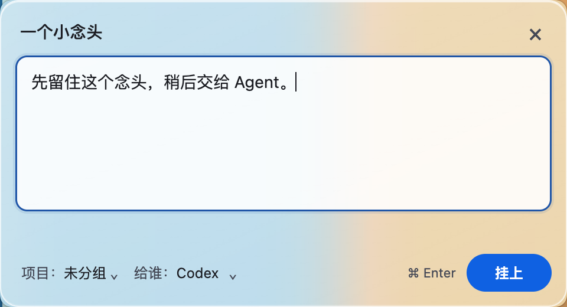
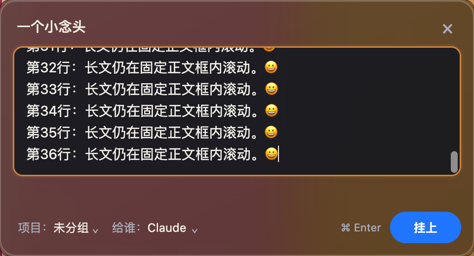

# 标题与行内属性：实际 Mac 预览

固定源码 `c0c4dd0a4161d19a09d94b2748c534921a4b1317`，分支 `codex/thoughtline-inline-composer-20261009`，版本 `0.0.16-preview.4`，工作树 `/Users/lihongwei/Documents/Codex/2026-10-09/task/thoughtline-inline-composer`。本轮按用户批准的标题位 / 行内项目与给谁 / 右侧挂上方案实现；主观视觉仍等用户看图，未打新包，0.0.15保持原冻结。

## 先看实际效果

| 当前 Mac 毛玻璃浅色 | 深色长文滚动 |
|---|---|
|  |  |

[另一背景的浅色](evidence/inline-composer/material/glass-light-alternate-background.png)、[恢复设置后的深色实色](evidence/inline-composer/material/restored-opaque-dark.png)、[原设置下默认实色](evidence/inline-composer/default-light-native-desktop.png)、[原设置下浅色长文](evidence/inline-composer/codex-long-scroll-light-native-desktop.png)。PNG为实际系统合成裁切960×520、DPR2，实际原生窗口480×260 DIP。背景只有自有假数据靶窗，未拍无关窗口、改壁纸或读取用户便签；没有 CSS blur 造桌面毛玻璃图。

名称是正文上方的轻量可选标题，默认焦点仍正文。正文固定132 DIP / 22 DIP行高，长文内部滚动；原设置下六场景均逐次记录原生bounds和renderer viewport，不随长文增高。项目和给谁相邻、具名文字入口；项目可以选择已有值、未分组或输入新值，键盘Enter选择 / 完成、Esc只关闭项目浮层。Agent保留全部自定义选项；当前值一直显示，超长值省略时可通过title提示和编辑 / 原生选项读取全文。项目 / Agent命中高度32，挂上完整72×32；名称、正文、项目、Agent、错误和组内迁移确认保留功能。蓝 / 暖赭 / 通用中性描边不染标题正文。没有新增绳上工具条或输入窗查找按钮。

底部保留小键提示、提交右侧收尾，状态区为失败和组内确认预留可滚动空间；不是把错误提示删除来缩短窗口。窗口从旧compact480×316缩至480×260；先前530×520和compact底部被用户否定 / 要求改进的事实保持历史，不能用本轮功能绿替代主观认可。

## 材质与设置恢复

用户明确批准仅为实测临时关闭“增强对比度”和“降低透明度”。测试前记录均为1（开启），通过正常系统设置UI临时改为0 / 0；原生实际记录 reducedTransparency=false、highContrast=false、forcedColors=false、material=vibrancy。准确Electron44.7.0使用NSVisualEffectView popover / behind-window材料；本机macOS15.3.1，**不是NSGlassEffectView或macOS26 Liquid Glass**，也没有Windows/Acrylic实机声明。[Electron窗口API](https://www.electronjs.org/docs/latest/api/base-window)、[nativeTheme API](https://www.electronjs.org/docs/latest/api/native-theme)。

两种自有背景下实际浅色窗口底色随背景变化，锐利条纹在窗口材质中被平滑；已实际查看浅 / 深三图及恢复图。ICC归一化到sRGB后的一个固定空白横带分析仅为局部证据：两场景邻接像素变化相对锐利背景的比值约0.09275 / 0.11683，换背景平均RGB变化约27.1942；不推广为所有区域模糊或对比度保证。[脚本与结果](evidence/inline-composer/material/background-response-check.json)及自有背景reference原图保留。

玻璃三图完成后立即隐藏自有窗口以便恢复设置，恢复完成再次显示窗口核验回退；不冒称本轮测试了物理前台切换的完整矩阵。北京时间2026-10-09 11:35:09（03:35:09 UTC）读取核验两项均恢复原值1。随后nativeTheme两项true、material=opaque，实际深色实色截图通过；系统设置返回原“通用”页面，其他设置 / 权限没有修改。[原值](evidence/inline-composer/material/original-preferences.json)、[临时值](evidence/inline-composer/material/temporary-preferences.json)、[恢复核验](evidence/inline-composer/material/restored-preferences.json)、[原生材料结果](evidence/inline-composer/material/material-result.json)。

## 本轮验证与限制

Node24.19：96单测 / 22文件、类型检查、构建均exit0；本轮当前源码的五项串行原生专项均exit0：

- 六个实色图场景：标题在正文上方、每场原生480×260 / 正文132、长文812 / 129 / scroll683、项目与Agent间4 DIP、完整提交按钮在footer与viewport内。
- [属性专项](evidence/inline-composer/properties-native.json)：已有项目键盘Enter、新项目Esc不关闭窗口、40字符项目 / 长Agent / 50字符标题边界、隐藏重开值与正文焦点、组内编辑警告和滚动确认可达并实际拆夹保全两条正文。
- [安全专项](evidence/inline-composer/safety-native.json)：当前11检查点，包含2.4秒合成组合负向等待 / revision / 草稿 / 原生可见 / 锁，正向检查点、失败保文重试、旧序号、三点击一条、迟到当前会话拒绝、编辑取消、dirty正常退出重启；查找是先X保存关闭解锁，再真实Tray MenuItem回调，非物理菜单点击。
- [SIGKILL检查点](evidence/inline-composer/crash-recovery.json)：磁盘完成检查点后，自有进程强制终止 / 重启，正文 / 名称 / 项目 / 自定义Agent恢复；不保证最后未ACK内容或编辑异常恢复、断电零丢失。
- 实际材质三图、两项原设置恢复核验、原生opaque回退图；无生产代码的偏好绕过。

诊断保留：首次crash fixture从按钮innerText提取项目附带展示换行，命令exit1；磁盘四字段当时正确，修为精确b.textContent后当前完整命令exit0。像素辅助脚本首次缩进错误exit1，修正后exit0。两项都属于证据脚本问题，不当产品故障，也不抹掉原失败；[诊断目录](evidence/inline-composer/diagnostics/crash-display-extraction-attempt-1.json)。

[源 / 五个编译输出绑定](evidence/inline-composer/source-binding.json)、[证据SHA索引](evidence/inline-composer/evidence-sha256.json)、[PID独立退出核验](evidence/inline-composer/process-exit-audit.json)。当前最终专项及保留失败尝试共48个记录PID均独立ps查无；各自假数据清理完成，无本轮DMG或新增安装。初次被后来同名结果覆盖的预览 / 安全运行也已各自清理，但不拼进48计数。历史原图 / 0.0.15包 / 旧QA原件保持。

以上是构建者实际Mac源码运行，独立QA本轮尚未重新审阅；没有新包、Windows CI / 实机、物理IME / 系统键盘 / 菜单 / 点击穿透 / 真实Agent / G7或完整设备矩阵结论。材质图不替用户接受视觉。`formalAcceptance=false`。本轮完成交接即停，下一大阶段由父会话新建本地任务接手。

复验时使用新证据输出目录，保留本冻结原件。材质fixture是受协调控制器管理的专项：必须在授权后记录原设置、清除本次输出的旧restore flag，截图就绪或任何失败立即通过系统UI恢复原设置并独立读取，再提交restore flag、核验回退和清理；不能当无人值守的系统设置修改命令运行。其他源码专项仅自有假数据 / 假快捷键，不触碰用户安装版。
