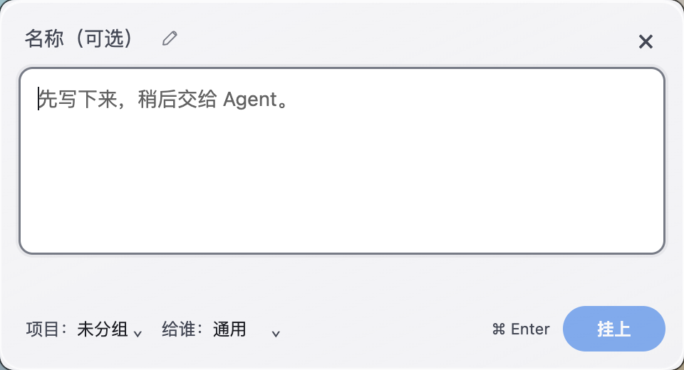
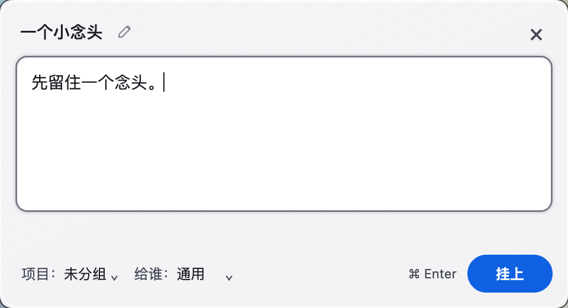

# 名称可编辑提示：视觉冻结与组合专项红证据

视觉源码 `4f8483af9e19883d1e5ed0ee76b6086f390d1135`，私有分支 `codex/thoughtline-name-affordance-20261009`，版本仍为 `0.0.16-preview.4`。从交接 `93efc57762e14177493af3015a2341a3d177c382` 建独立 worktree；旧 source `c0c4dd0a4161d19a09d94b2748c534921a4b1317` / evidence `fb214fe16d9628c2a402cd4854fff705ff909627` 均保留。当前仅源码运行，没有新安装包，0.0.15冻结不变。

用户认可480×260行内布局后要求名称可发现性；已有placeholder“名称（可选）”不重复改。最终名称旁常显轻量铅笔，input和铅笔悬停均提示“点击修改名称”；单击名称直接编辑、单击图标聚焦名称，原生双击选择文字可用，键盘可达图标并Enter聚焦名称。名称辅助描述说明可选及首行回退；focus为1 DIP细线，hover/focus轻底色。名称按内容宽度、长名受限，关闭按钮仍完整；没有大矩形默认标题框、编辑模式或双击门槛。

| 默认空名称，正文默认焦点 | 已填写“一个小念头”，铅笔常显 |
|---|---|
|  |  |

[铅笔单击后的名称焦点](evidence/name-affordance/filled-name-pencil-focus-light-native-desktop.png)、[50字名称](evidence/name-affordance/long-name-light-native-desktop.png)、[深色空名称](evidence/name-affordance/default-empty-dark-native-desktop.png)、[深色键盘聚焦](evidence/name-affordance/empty-name-keyboard-focus-dark-native-desktop.png)。全部实际Mac系统合成裁切960×520 / DPR2，480×260 DIP原生窗口，只包含自有窗口与自有假背景。系统增强对比/降低透明保持原值1/1，因此为实际opaque回退；本轮没有新玻璃或Windows实际截图声明。

最终96unit / 22文件、typecheck / build、名称原生专项exit0。10个检查点 / 10场景：空名称/通用Agent/正文默认焦点，轻hover与单击焦点，键盘Shift+Tab与图标Enter，普通Enter不提交，Tab顺序，Esc保存名称与正文后重开正文焦点，空名称⌘Enter首行回退，已填名称常显铅笔/单击/双击/可访问描述与tooltip，50字名称不挤铅笔/关闭/底部，手动名称与Agent提交和正文132固定内滚动，系统偏好不变。名称、正文、项目与给谁、右侧72×32挂上始终在480×260内；正文Agent描边和原底部布局保持。

## 组合输入补充专项：明确红证据

QA建议在两个可选字段上补合成composition检查。最终视觉源码上串行probe为**exit2**：名称等待2400ms，revision0→1并存“未确认名称ming”；项目等待2400ms，revision3→4并存“未确认项目xiang”。两个“不应提前存中间值”检查点失败。原先7054e70同样复现，而其Composer.tsx与c0原源码完全同SHA；视觉修改没有增加或改动组合暂停/恢复handler。此为原有行为缺口，不凭它声明物理IME故障或数据损坏。

每字段6项带isComposing=true或keyCode229的Enter / Escape / ⌘Enter均保护窗口可见、锁和idea计数，项目浮层不关闭；compositionend后完整值内存/磁盘checkpoint通过，随后普通Esc、项目Enter、⌘Enter提交完整名称/项目通过。[原红结果](evidence/name-affordance/composition-probe/result.json)、[复现脚本](../tests/electron/optional-composition-probe.cjs)。父已授权继续独立新提交修复composition pause/resume与flush保护，**不混入本视觉源码提交**。新绿证据需单独报告，物理IME仍未测。

## 清理、诊断与后续边界

[绑定](evidence/name-affordance/source-binding.json)、[85件证据SHA索引](evidence/name-affordance/evidence-sha256.json)、[28个自有记录PID独立ps退出核验](evidence/name-affordance/process-exit-audit.json)。所有本阶段记录PID均不存在，所有自有假数据目录已清；首次沙盒启动没有取得App句柄，其假数据在独立核无对应Electron命令后删除，诊断保留。原开发工作树、用户安装版/真实笔记、系统偏好未修改。

开发失败不隐藏：首次普通沙盒无法启动原生Electron，随后在授权原生环境完成；首次铅笔实现50字名称撑大Grid布局，修为header min-width:0后最终完整专项exit0。分别保留于`evidence/name-affordance-hover-only/diagnostics`和`evidence/name-affordance-pencil-attempt-1/native-failed-long-name-attempt-1.log`。两个先前目录是中间开发尝试，不冒称最终源码证据。hover-only source为7054e70a450ef78d7e552d7cf372336394e8a0be，旧编译哈希为当时记录，不指当前out。

独立QA待审最终视觉及红证据；组合修复下一提交尚未实施，本报告不写全面安全通过。未打包、合并main、发布、替换安装版或集成另一线程的应用图标。下一包阶段至少需要：组合修复新绿与独立QA、用户最终图反馈、应用图标线程准确批准资源/哈希、确定包版本与源码/依赖冻结、Mac隔离新包运行验收与清理、Windows对应CI/安装器哈希及明确实机未测边界。物理IME/系统快捷键与菜单、G7、真实Agent及完整设备矩阵继续未验。`formalAcceptance=false`。
