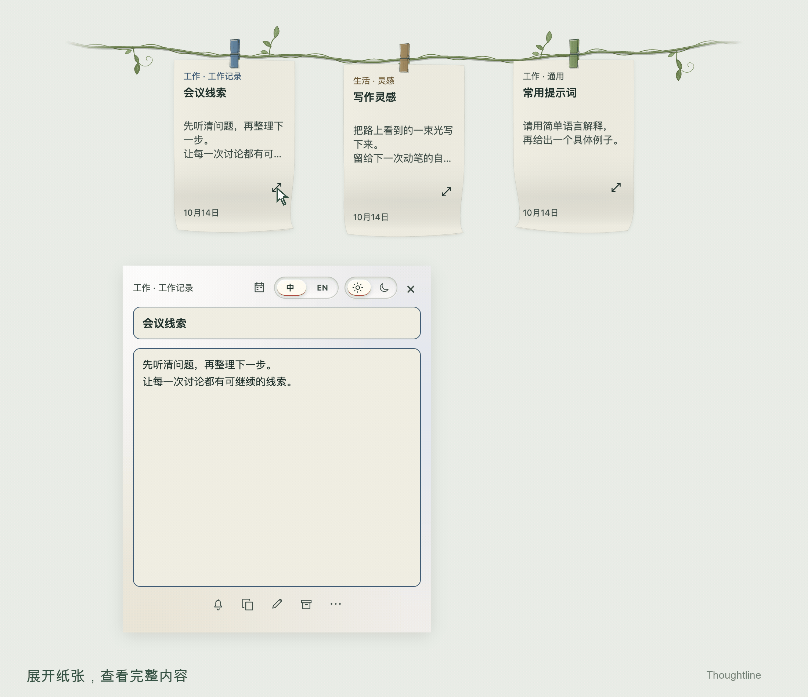
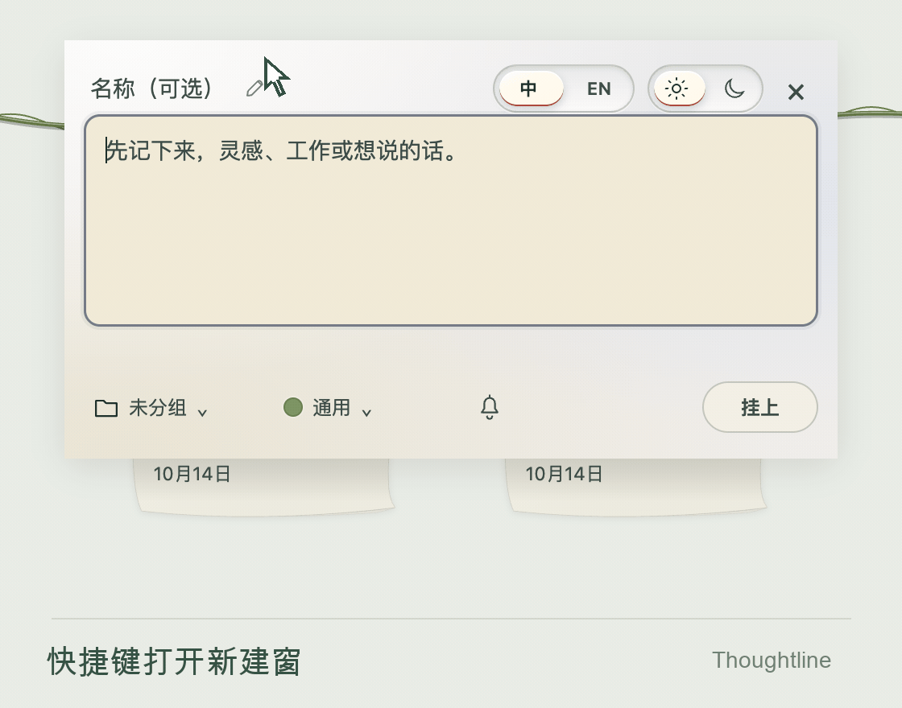
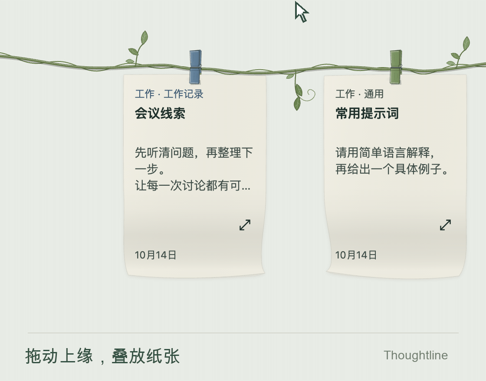
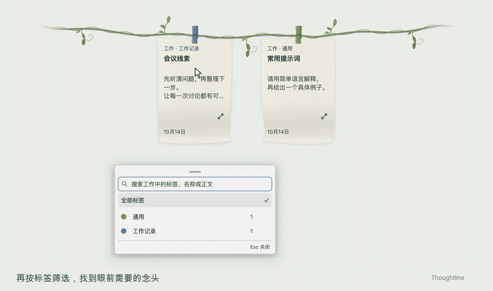
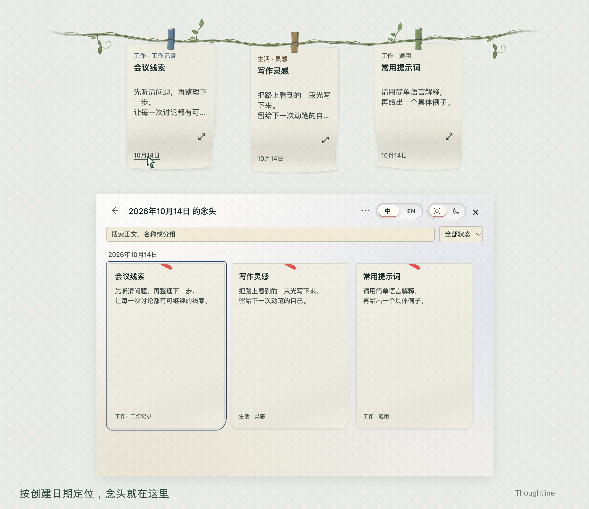

<h1 align="center">
   
  晾念头 · Thoughtline
</h1>

  <strong>Accrochez une idée. Retrouvez-la à portée de main.</strong> 
  Une liane en haut du bureau pour vos idées, notes et prompts réutilisables.

  
  
  

<a href="../../README.md">中文</a> · <a href="../../docs/readme/README.en.md">English</a> · <a href="../../docs/readme/README.ja.md">日本語</a> · <a href="../../docs/readme/README.ko.md">한국어</a> · <a href="../../docs/readme/README.es.md">Español</a> · <a href="../../docs/readme/README.fr.md">Français</a> · <a href="../../docs/readme/README.pt.md">Português</a>

<h2 align="center"><a href="https://github.com/NocodeMrLi/thoughtline/releases/tag/v0.0.35">Télécharger Thoughtline</a></h2>

macOS Apple Silicon · Windows x64 · 0.0.35

Thoughtline est une application de notes pour macOS et Windows. Placez le pointeur au bord supérieur pour dérouler le fil et ses notes ; éloignez-le pour les ranger. Gardez les textes utiles sur des pinces colorées et retrouvez les autres grâce aux groupes, étiquettes et au calendrier.

   
  Déployer → Lire la note complète → Copier → Replier · <a href="demos/vine-overview.png">Aperçu fixe</a>

Les démonstrations utilisent une liane, des notes fictives et l’interface en chinois.

## Pour vos idées du quotidien

- Notes de réunion, pistes de tâches et petits mémos de travail.
- Idées d’écriture et pensées à reprendre plus tard.
- Prompts, réponses et textes de référence utilisés régulièrement.

## Écrire, accrocher, utiliser, retrouver

1. **Écrire** : ouvrez une note par raccourci ou clic droit et choisissez groupe et étiquette.
2. **Accrocher** : gardez les notes du moment sur le fil et empilez les feuilles liées sur une pince.
3. **Utiliser** : ouvrez le texte complet pour lire, modifier, copier ou faire glisser vers une autre application.
4. **Retrouver** : rangez dans le calendrier, puis cherchez par date ou par texte.

## Fonctionnalités

<strong>Saisie rapide　·　Empiler par glisser</strong>

  
  

Saisie rapide · <a href="demos/quick-capture.png">Aperçu fixe</a>　｜　Empiler par glisser · <a href="demos/drag-stack.png">Aperçu fixe</a>

### Notes et brouillons

Un titre ou un texte suffit. Conservez une note non envoyée comme brouillon ; les modifications dans la lecture agrandie ou le calendrier s’enregistrent après une courte pause.

### Groupes et étiquettes

Classez travail, vie personnelle ou projets par groupe, puis ajoutez une étiquette de thème ou d’usage. Les filtres sont indépendants et se croisent lorsqu’ils sont combinés. Ils préservent les piles et positions. Cherchez une étiquette par son nom, un titre ou les mots du texte.

   
  Choisir un groupe → Filtrer par étiquette → Tout afficher · <a href="demos/groups-and-tags.png">Aperçu fixe</a>

### Feuilles empilées, lecture individuelle

Un groupe accepte des étiquettes différentes dans une pile ; hors groupe, l’étiquette doit être la même. Chaque feuille garde titre, texte, étiquette, couleur, rappel et date. Feuilletez, ouvrez la liste des titres depuis le numéro de page ou séparez une feuille.

### Du fil au calendrier

Cherchez une destination compatible sur le fil ou dans le calendrier. Une pile fusionnée dans le calendrier y reste, même après séparation. Déplacez la pince entière ou tirez une feuille par son bord supérieur. Le rangement automatique resserre les positions ; la dernière action valide peut être annulée. Les petits panneaux se déplacent et se ferment par Échap ou clic extérieur.

### Retrouver les dates d’origine

Explorez jours, mois et années ; cherchez titres, texte, groupes et étiquettes ou filtrez par état. Cliquez sur la date d’une feuille suspendue pour la retrouver. Les piles indiquent le vrai nombre de feuilles ; chaque membre reste accessible à sa date de création.

   
  Cliquer sur la date → Retrouver la note → Ouvrir le texte complet · <a href="demos/calendar-revisit.png">Aperçu fixe</a>

### Emporter le texte complet

Copiez ou faites glisser du texte brut en gardant la note originale. Une confirmation apparaît près du bouton. Vous choisissez la destination ; aucun texte n’est envoyé automatiquement à une application ou un service d’IA.

### Rappel ponctuel

La cloche programme une notification système. Elle nécessite l’autorisation du système et une application ouverte. Les rappels manqués pendant sa fermeture sont signalés à la réouverture.

### Écrire quand le fil est plein

Choisissez 4, 6 ou 8 pinces, avec 6 par défaut. Enregistrez dans le calendrier ou remplacez une note suspendue en rangeant l’ancienne. Les notes rangées volontairement restent dans le calendrier jusqu’à ce que vous les raccrochiez.

### Conserver ou effacer le contenu

Créez, renommez, retirez de la sélection et rétablissez les classifications. La suppression conserve et déplace le contenu par défaut. L’effacement définitif présente une liste dans le même dialogue et exige confirmation. Une étiquette couvre tous les groupes et brouillons liés. Général et Sans groupe sont protégés.

## Téléchargement et installation

Version actuelle : **0.0.35**, distribuée via Releases. Le téléchargement nécessite l’accès au dépôt.

| Plateforme | Installation |
| --- | --- |
| macOS · Apple Silicon | [Thoughtline-0.0.35-mac-arm64.dmg](https://github.com/NocodeMrLi/thoughtline/releases/tag/v0.0.35) |
| Windows · x64 | [Thoughtline-0.0.35-win-x64.exe](https://github.com/NocodeMrLi/thoughtline/releases/tag/v0.0.35) |

Sur Mac, ouvrez le DMG et glissez Thoughtline dans Applications. Sous Windows, lancez l’EXE. Quittez normalement l’ancienne version et gardez une sauvegarde indépendante avant mise à jour. Les mises à jour se téléchargent manuellement.

Le paquet Mac utilise une signature ad-hoc et n’est pas notarié. Le paquet Windows n’est pas signé. Le système peut afficher une demande de confiance.

## Votre première note

1. Appuyez sur `Control + Alt + N`, ou `⌃ + ⌥ + N` sur Mac. Le raccourci se modifie dans les réglages.
2. `Enter` ajoute une ligne. Validez avec `⌘ + Enter` sur Mac ou `Ctrl + Enter` sous Windows. Dans une nouvelle note, `Esc` enregistre le brouillon et ferme la fenêtre.
3. Placez le pointeur en haut pour afficher le fil. Ouvrez une feuille pour la lire ; le clic droit donne accès à la création, aux filtres, au calendrier et au rangement.
4. Le menu Plus du calendrier contient les notes récemment supprimées, les groupes et étiquettes, ainsi que le stockage et les réglages.

## Un fil à votre goût

Choisissez fil classique, coton tressé ou vigne légère dans les réglages d’apparence. Le fil classique est colorable ; coton et vigne gardent leur couleur naturelle. Les pinces suivent la couleur des étiquettes.

Cinq teintes douces de papier, des feuilles vierges, lignées ou à pointillés : prévisualisez puis appliquez. L’interface propose chinois et anglais, thèmes clair, sombre ou système.

## Données, export et suppression

Les notes sont locales. Consultez le dossier, migrez le stockage ou exportez une sauvegarde JSON. La migration copie et vérifie avant de changer, en conservant l’original. TXT et DOCX exportent titres et texte ; JSON sauvegarde les données complètes des notes.

Une suppression ordinaire permet la restauration depuis les notes récemment supprimées. L’effacement définitif supprime les enregistrements actuels sans y passer et sans annulation ordinaire ; les sauvegardes et exports existants restent. Effacer une classification inclut son contenu sur le fil, dans le calendrier, les notes supprimées et les brouillons.

Gardez une copie indépendante avant mise à jour ou changement d’ordinateur. Préservez les données actuelles et vérifiez la compatibilité avant restauration d’une ancienne sauvegarde ou retour à une version antérieure.

## Questions fréquentes

### Comment combiner groupes et étiquettes ?

Travail peut être un groupe et Rapport quotidien une étiquette. L’étiquette seule cherche dans tous les groupes ; les deux filtres ensemble donnent leur intersection.

### Ranger et supprimer : quelle différence ?

Ranger déplace dans le calendrier ; supprimer normalement permet de restaurer ; effacer définitivement retire les enregistrements actuels. Le nettoyage des classifications conserve le contenu par défaut.

### Faut-il un compte ou un service cloud ?

L’utilisation ne nécessite pas de compte Thoughtline. Cette version conserve des fichiers locaux et sauvegardes ; transférez vos sauvegardes vous-même pour changer d’appareil. L’accès au téléchargement est distinct.

### Une étiquette Codex se connecte-t-elle à l’IA ?

Les étiquettes servent à organiser vos textes et ne connectent aucune API d’agent. Copiez ou glissez le prompt pour l’utiliser.

## Retours et contact

Contactez l’auteur dans Stockage et réglages, ou via [GitHub Issues](https://github.com/NocodeMrLi/thoughtline/issues) si vous avez accès. Indiquez système, version, étapes et résultat attendu ou obtenu. Masquez les informations personnelles dans les exemples.

## Licence et remerciements

Le code est marqué `UNLICENSED` ; aucune licence open source n’a été accordée. Les licences tierces figurent dans les [mentions des tiers](../../THIRD_PARTY_NOTICES.md).

La documentation existe en sept langues. L’interface de l’application prend en charge le chinois et l’anglais.
