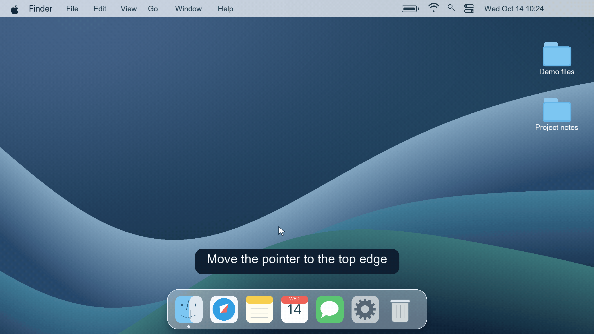
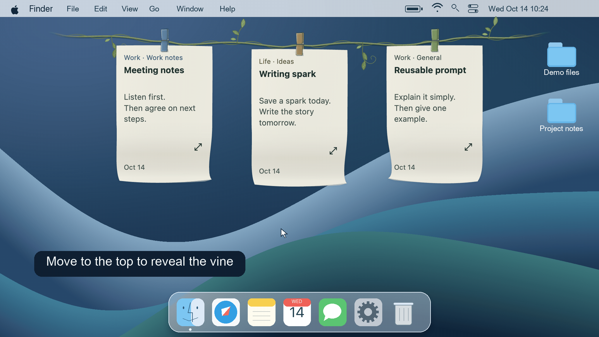
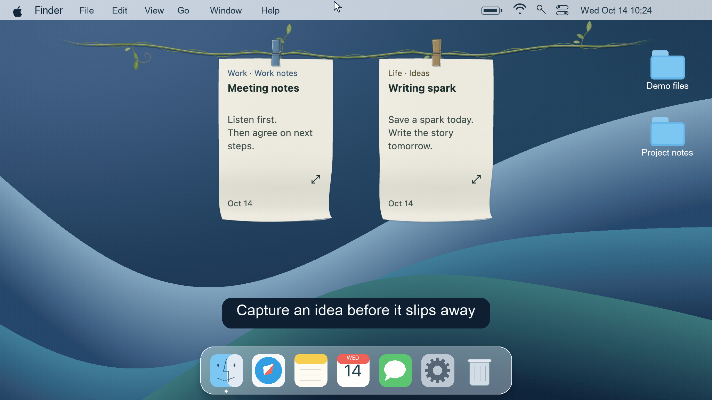
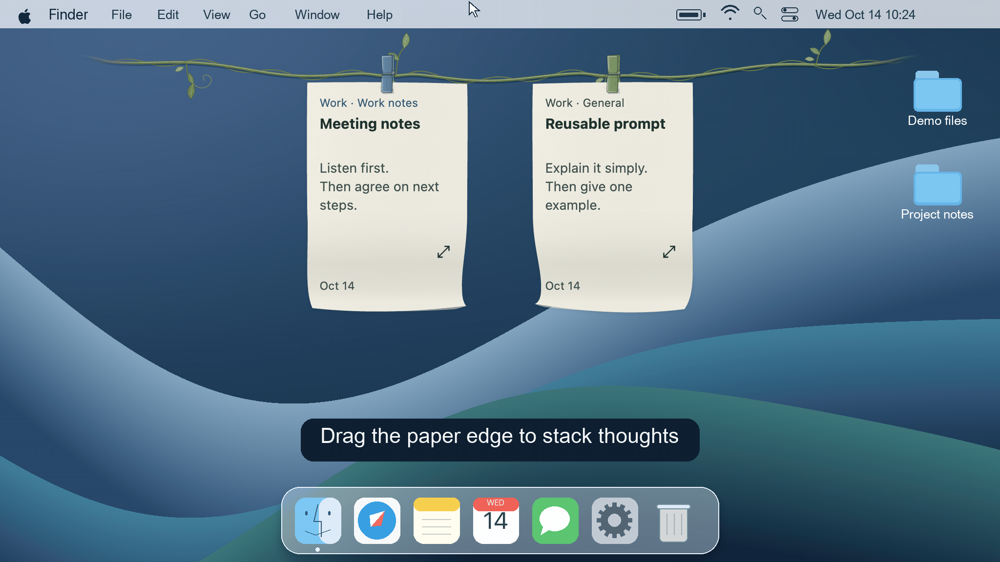
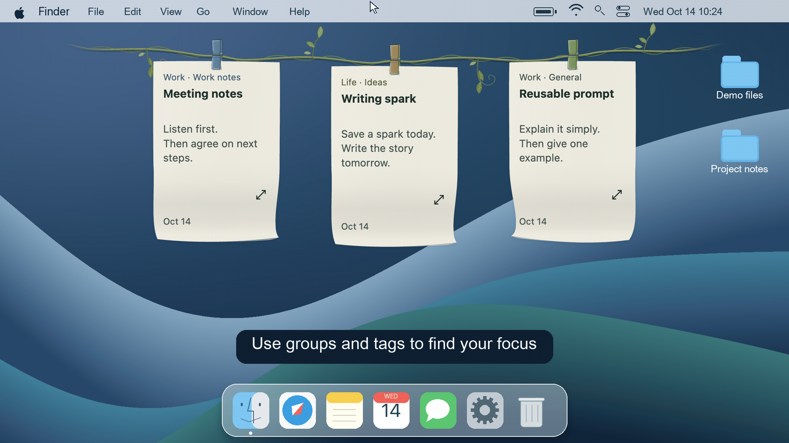
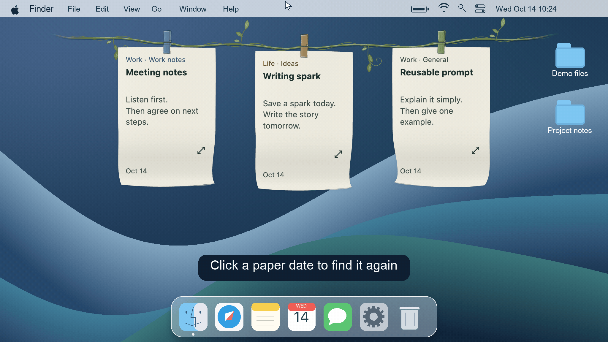
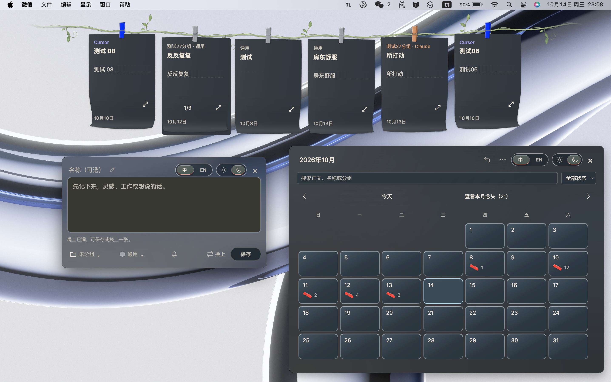
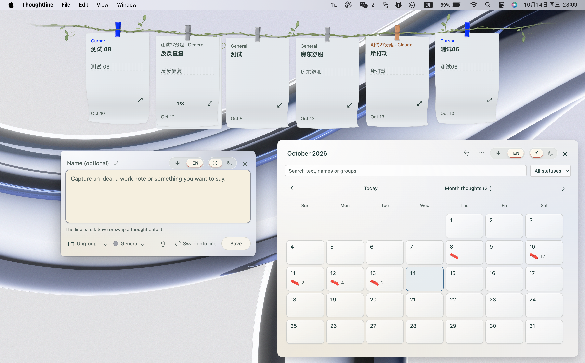

<h1 align="center">
   
  晾念头 · Thoughtline
</h1>

  <strong>Pendure uma ideia. Retome-a quando precisar.</strong> 
  Uma trepadeira no topo da área de trabalho para ideias, notas e prompts reutilizáveis.

  
  
  

<a href="../../README.md">中文</a> · <a href="../../docs/readme/README.en.md">English</a> · <a href="../../docs/readme/README.ja.md">日本語</a> · <a href="../../docs/readme/README.ko.md">한국어</a> · <a href="../../docs/readme/README.es.md">Español</a> · <a href="../../docs/readme/README.fr.md">Français</a> · <a href="../../docs/readme/README.pt.md">Português</a>

<h2 align="center"><a href="https://github.com/NocodeMrLi/thoughtline/releases/tag/v0.0.37">Baixar Thoughtline</a></h2>

macOS Apple Silicon · Windows x64 · 0.0.37

Thoughtline é um aplicativo de notas para macOS e Windows. Leve o cursor à borda superior para revelar a corda e as notas; afaste-o para recolher. Mantenha o que precisa em prendedores coloridos e organize o restante com grupos, etiquetas e calendário.

<strong>Clique para copiar　·　Arrastar texto para o chat</strong>

  
  

Clique para copiar · <a href="demos/en/vine-overview.png">Prévia estática</a>　｜　Arrastar texto para o chat · <a href="demos/en/text-drag.png">Prévia estática</a>

<a href="#real-interface">Ver a interface real</a>

As demonstrações usam uma mesa macOS simulada, uma trepadeira, notas fictícias e a interface em inglês. Os menus seguem a estrutura do produto; o chat é ilustrativo.

## Um lugar para suas ideias

- Notas de reuniões, tarefas a explorar e registros de trabalho.
- Ideias de escrita e pensamentos para retomar depois.
- Prompts, respostas e textos de referência usados com frequência.

## Escreva, pendure, use e retome

1. **Escreva**: abra com atalho ou botão direito e escolha grupo e etiqueta.
2. **Pendure**: mantenha as notas atuais na corda e empilhe folhas relacionadas num prendedor.
3. **Use**: abra o texto completo para ler, editar, copiar ou arrastar para outro aplicativo.
4. **Retome**: recolha para o calendário e encontre por data ou pesquisa.

O ícone de menu ou bandeja oferece pausar e retomar o hover e sair. Crie notas pelo atalho ou menu da nota; as configurações ficam em Mais no calendário.

## O que você pode fazer

<strong>Registro rápido　·　Empilhar arrastando</strong>

  
  

Registro rápido · <a href="demos/en/quick-capture.png">Prévia estática</a>　｜　Empilhar arrastando · <a href="demos/en/drag-stack.png">Prévia estática</a>

### Notas e rascunhos

Um título ou corpo de texto basta para salvar. Guarde conteúdo ainda não enviado como rascunho; edições na leitura ampliada ou calendário são salvas após uma breve pausa.

### Grupos e etiquetas

Organize trabalho, vida pessoal ou projetos por grupo e use etiquetas para temas e finalidades. Os filtros são independentes e combinam por interseção, preservando pilhas e posições. Pesquise etiquetas por nome, título da nota ou palavras do texto.

   
  Escolher um grupo → Filtrar por etiqueta → Mostrar tudo · <a href="demos/en/groups-and-tags.png">Prévia estática</a>

### Empilhar e ler folha por folha

Um grupo admite etiquetas diferentes na mesma pilha; notas sem grupo combinam pela mesma etiqueta. Cada folha conserva título, texto, etiqueta, cor, lembrete e data. Vire páginas, abra a lista de títulos pelo número da página ou separe uma folha.

### Corda e calendário conectados

Pesquise destinos compatíveis na corda ou calendário. Pilhas combinadas no calendário ficam lá, inclusive após separadas. Arraste o prendedor para mover a pilha ou a borda superior para tirar uma folha. Organize posições automaticamente e desfaça a última ação válida. Os painéis podem ser movidos e fecham com Esc ou clique fora.

### Encontrar a data original

Navegue por dia, mês e ano; pesquise títulos, texto, grupos e etiquetas ou filtre por estado. Clique na data de uma folha pendurada para localizá-la. As pilhas exibem a quantidade real; cada membro mantém a própria data de criação.

   
  Clicar na data → Localizar a nota → Abrir o texto completo · <a href="demos/en/calendar-revisit.png">Prévia estática</a>

### Levar o texto completo

Copie ou arraste texto simples mantendo a nota original. A confirmação aparece perto do botão. Você escolhe o destino; o aplicativo não envia texto automaticamente a outros aplicativos ou serviços de IA.

### Agendar um lembrete

O sino agenda uma notificação única. É preciso permitir notificações e manter o aplicativo aberto. Lembretes perdidos enquanto estava fechado aparecem ao reabrir.

### Continuar com a corda cheia

Escolha 4, 6 ou 8 prendedores; o padrão é 6. Salve no calendário ou substitua uma nota pendurada, recolhendo a anterior. Notas recolhidas manualmente ficam no calendário até você pendurá-las outra vez.

### Conservar ou limpar conteúdo

Crie, renomeie, retire da seleção e restaure classificações. Excluir conserva e transfere o conteúdo por padrão. A exclusão definitiva apresenta a lista no mesmo diálogo e exige confirmação. Uma etiqueta abrange notas de todos os grupos e rascunhos relacionados. Geral e Sem grupo são protegidos.

## Download e instalação

Versão atual: **0.0.37**, distribuída pelo Releases. O download exige acesso ao repositório.

| Plataforma | Instalador |
| --- | --- |
| macOS · Apple Silicon | [Thoughtline-0.0.37-mac-arm64.dmg](https://github.com/NocodeMrLi/thoughtline/releases/tag/v0.0.37) |
| Windows · x64 | [Thoughtline-0.0.37-win-x64.exe](https://github.com/NocodeMrLi/thoughtline/releases/tag/v0.0.37) |

No Mac, abra o DMG e arraste Thoughtline para Aplicativos. No Windows, execute o EXE. Feche normalmente a versão antiga e mantenha uma cópia independente antes de atualizar. Atualizações são baixadas manualmente.

O pacote Mac usa assinatura ad-hoc e não é notarizado. O pacote Windows não é assinado. O sistema pode exibir um aviso de confiança.

## Sua primeira nota

1. Pressione `Control + Alt + N`; no Mac, `⌃ + ⌥ + N`. Altere o atalho nos ajustes.
2. `Enter` quebra a linha. Envie com `⌘ + Enter` no Mac ou `Ctrl + Enter` no Windows. Na nota nova, `Esc` salva o rascunho e fecha a janela.
3. Leve o cursor ao topo. Abra uma folha para ler tudo; o botão direito oferece criar, filtrar, abrir calendário e organizar.
4. O menu Mais do calendário reúne excluídas recentemente, grupos e etiquetas, e armazenamento e ajustes.

## Personalize sua corda

Nos ajustes de aparência, escolha corda clássica, algodão trançado ou trepadeira leve. A clássica admite cores; algodão e trepadeira conservam tons naturais. Prendedores seguem a cor da etiqueta.

Escolha cinco cores suaves e papel em branco, pautado ou tracejado. Veja a prévia e aplique. A interface oferece chinês e inglês e temas claro, escuro ou do sistema.

  
  

Tema escuro · Interface chinesa　｜　Tema claro · Interface inglesa Aparência real no macOS. O Windows tem pequenas diferenças do sistema; as funções são as mesmas.

## Dados, exportação e exclusão

Notas ficam em arquivos locais. Consulte a pasta, migre o armazenamento ou exporte JSON nos ajustes. A migração copia e verifica antes de mudar e mantém o original. TXT e DOCX exportam títulos e texto; JSON guarda os dados completos das notas.

Excluir normalmente permite restaurar das excluídas recentemente. A exclusão definitiva limpa registros atuais, sem passar por essa lista nem permitir desfazer; cópias automáticas e exportações existentes ficam. Excluir uma classificação definitivamente inclui seu conteúdo na corda, calendário, excluídas recentemente e rascunhos.

Mantenha cópia independente antes de atualizar ou trocar de computador. Preserve dados atuais e confira compatibilidade antes de restaurar uma cópia antiga ou voltar de versão.

## Perguntas frequentes

### Como combinar grupos e etiquetas?

Trabalho pode ser um grupo e Relatório diário uma etiqueta. Só a etiqueta encontra notas em todos os grupos; ambos os filtros mostram a interseção.

### Qual é a diferença entre recolher e excluir?

Recolher leva ao calendário; excluir normalmente permite restaurar; excluir definitivamente remove registros atuais. Ao limpar classificações, conservar e transferir é o padrão.

### Preciso de conta ou serviço de nuvem?

O uso dispensa conta Thoughtline. Esta versão usa arquivos e cópias locais; transfira seus backups ao mudar de aparelho. A permissão de download é separada do uso.

### A etiqueta Codex conecta à IA?

Etiquetas organizam textos e não conectam APIs de agentes. Copie ou arraste um prompt quando quiser usá-lo.

## Feedback e contato

Contate o autor em Armazenamento e ajustes, ou pelo [GitHub Issues](https://github.com/NocodeMrLi/thoughtline/issues) com acesso ao repositório. Informe sistema, versão, passos e resultados esperado e real. Remova dados pessoais dos exemplos e imagens.

## Licença e agradecimentos

O código está marcado `UNLICENSED`; nenhuma licença de código aberto foi concedida. As licenças de terceiros ficam nos [avisos de terceiros](../../THIRD_PARTY_NOTICES.md).

A documentação está disponível em sete idiomas. A interface do aplicativo oferece chinês e inglês.
