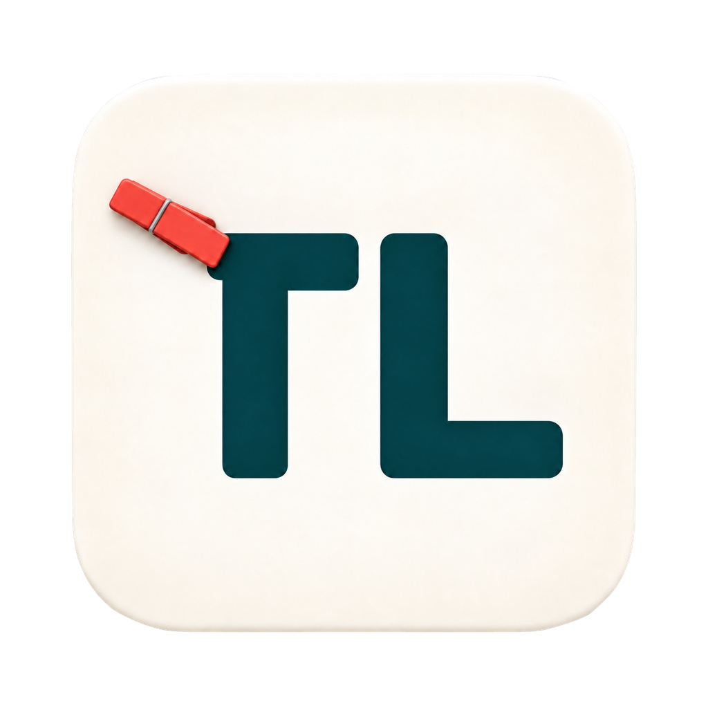
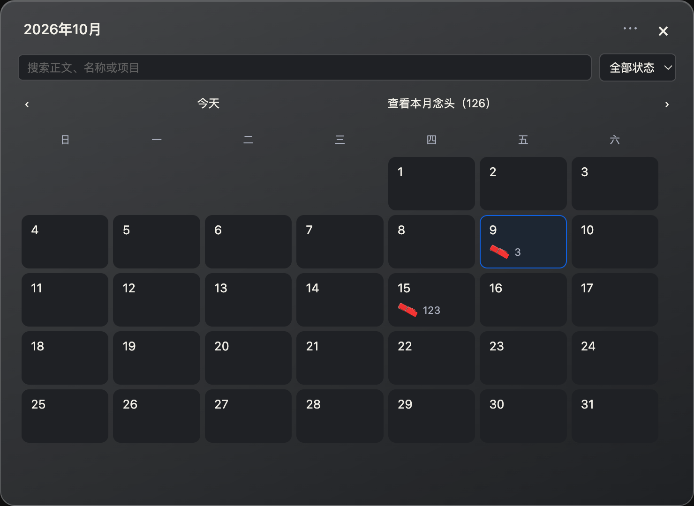

<h1 align="center">
   晾念头 · Thoughtline
</h1>

<p align="center">
  <a href="https://github.com/NocodeMrLi/thoughtline/stargazers"></a>
  <a href="https://github.com/NocodeMrLi/thoughtline/releases"></a>
  <a href="#license"></a>
  <a href="https://github.com/NocodeMrLi/thoughtline/releases/tag/v0.0.17-preview.3"></a>
  <a href="https://github.com/NocodeMrLi/thoughtline/issues"></a>
  <a href="https://github.com/NocodeMrLi/thoughtline/releases/tag/v0.0.17-preview.3"></a>
</p>

<p align="center">
  <sub><a href="../../README.md">中文</a> · <a href="../../docs/readme/README.en.md">English</a> · <a href="../../docs/readme/README.ja.md">日本語</a> · <a href="../../docs/readme/README.ko.md">한국어</a> · <a href="../../docs/readme/README.es.md">Español</a> · <a href="../../docs/readme/README.fr.md">Français</a> · <a href="../../docs/readme/README.pt.md">Português</a></sub>
</p>

<p align="center">
  <strong>Pendure uma ideia. Deixe a inspiração por perto.</strong><br />
  Uma corda, alguns prendedores e folhas para as ideias do dia a dia.
</p>

<h2 align="center"><a href="https://github.com/NocodeMrLi/thoughtline/releases/tag/v0.0.17-preview.3"><ins>Baixar Thoughtline</ins></a></h2>

<p align="center"><sub>macOS Apple Silicon · Windows x64 · 0.0.17-preview.3</sub></p>

Thoughtline é uma ferramenta leve para macOS e Windows. Abra suas ideias na borda superior da tela, registre um pensamento e volte ao que estava fazendo.

## Recursos

- Registre título, texto e categoria com um atalho; mantenha notas incompletas como rascunhos.
- Uma corda na área de trabalho com prendedores e papel; novas ideias usam a categoria Geral.
- Mova um prendedor inteiro ou separe uma folha; una prendedores compatíveis e desfaça a organização.
- Edite na visualização detalhada ou no calendário, com salvamento após uma breve pausa e troca imediata de página.
- Navegue por dia, mês ou ano; pesquise e filtre também ideias arquivadas.
- Restaure notas em Excluídos recentemente. Excluir um projeto mantém suas ideias.
- Copie ou arraste texto simples. A nota original permanece e nada é enviado automaticamente.
- Guarde dados localmente; veja a pasta real, mova-a ou exporte um backup independente.
- Alterne chinês/inglês e modo claro/escuro nas primeiras janelas, ou acompanhe o sistema; o papel continua suave e legível.

<p align="center"><br /><sub>Calendário de ideias com dados sintéticos de demonstração.</sub></p>

## Download e instalação

Esta é uma versão de prévia para membros com acesso ao repositório. Releases inclui pacotes, inicializadores isolados, SHA256SUMS e origem das compilações. [Releases](https://github.com/NocodeMrLi/thoughtline/releases/tag/v0.0.17-preview.3).

| Platform | Package |
|---|---|
| macOS · Apple Silicon | arm64 · DMG |
| Windows | x64 · EXE (NSIS) |

Antes de atualizar, encerre normalmente e faça backup dos dados. Mac usa assinatura ad-hoc, sem Developer ID ou notarização; Windows não é assinado. Mantenha as proteções do sistema. Não há atualização automática.

## Primeiros passos

1. Control + Alt + N (⌃ + ⌥ + N no Mac) abre uma nota; altere o atalho nas configurações.
2. Enter insere uma nova linha. Confirme com ⌘ + Enter no Mac ou Ctrl + Enter no Windows. Esc salva o rascunho e fecha a entrada.
3. Leve o ponteiro à borda superior para mostrar a corda; abra uma folha para ler, copiar, editar ou arquivar.
4. Encontre ideias arquivadas no calendário ou restaure as excluídas recentemente.

Codex, Claude e Cursor são categorias. Copie ou arraste o texto manualmente; o recebimento em outros aplicativos ainda está em verificação.

## Dados e backups

As configurações do calendário mostram a pasta real. A mudança copia e verifica antes de trocar a pasta; mantém o original. Exportar um backup não altera a localização atual. [Data / 备份说明](../ROUND1-DATA-SAFETY.md).

O formato atual é schema3. A versão 0.0.16-preview.6 não pode lê-lo diretamente. Preserve os novos dados e valide um backup anterior em uma pasta separada antes de voltar à versão antiga. Esse backup não contém alterações posteriores.

## Desenvolvimento

Use Node.js 24.19.0 ou uma versão 24.x mais recente. verify executa verificação de tipos, testes unitários e compilação. Gere cada pacote no sistema correspondente. Tecnologias: Electron, React, TypeScript e Vite.

```bash
npm ci
npm run dev
```

```bash
npm run verify
npm run package:mac
npm run package:win
```

As verificações automáticas e de pacotes aplicáveis passaram. IME, DPI, múltiplas telas, foco e campos reais do WeChat, Doubao e WorkBuddy ainda precisam de testes independentes. A interface oferece chinês e inglês. Alterne o idioma e o modo claro/escuro diretamente no canto superior direito das janelas de escrita, detalhes ou calendário; nas configurações, você pode voltar a seguir o sistema. Os sete links traduzem o README, não representam sete idiomas da interface.

## Feedback

Use Issues para problemas e ideias. Inclua versões, passos, resultados esperados e reais e evidências sem informações pessoais. Não envie pensamentos ou dados reais. [Issues](https://github.com/NocodeMrLi/thoughtline/issues).

Estrelas e downloads: retrato da API em 2026-10-09. Downloads contam arquivos das publicações.

<a id="license"></a>
## Licença e agradecimentos

O projeto está UNLICENSED; nenhuma permissão de uso como código aberto foi concedida. Uma futura publicação definirá a licença e as contribuições. Consulte os avisos de terceiros para o código e as licenças incluídos. [Third-party notices](../../THIRD_PARTY_NOTICES.md).
